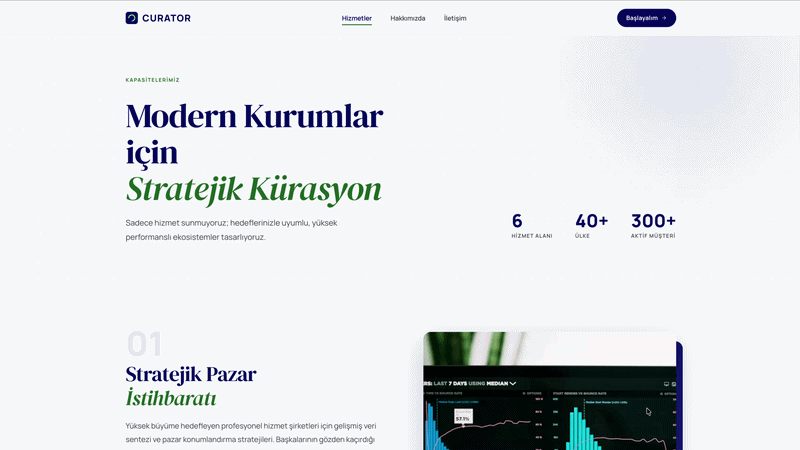

# CURATOR — Profesyonel Hizmetler Web Sitesi

Modern, editorial tasarım anlayışıyla geliştirilmiş kurumsal web sitesi. Saf HTML5, CSS3 ve Vanilla JS. Herhangi bir framework veya build aracı gerektirmez.

---

## Ekran Görüntüsü



## 🚀 Kurulum

Build adımı yoktur. Doğrudan tarayıcıda aç:
```bash
# Lokal sunucu başlat (önerilen)
npx serve .

# veya
python -m http.server 8000
```

Sonra tarayıcıda `http://localhost:8000` adresini aç.

---

## 📁 Proje Yapısı
```
curator/
├── index.html
├── assets/
│   ├── css/
│   │   ├── style.css        ← Global (nav, footer, reset, değişkenler)
│   │   ├── index.css        ← Ana sayfa
│   │   ├── hizmetler.css    ← Hizmetler sayfası
│   │   ├── hakkimizda.css   ← Hakkımızda sayfası
│   │   └── iletisim.css     ← İletişim sayfası
│   ├── js/
│   │   ├── main.js          ← Global (nav, hamburger menü)
│   │   ├── index.js         ← Ana sayfa (reveal, sayaç animasyonu)
│   │   ├── reveal.js        ← Scroll reveal (pages/ için ortak)
│   │   └── iletisim.js      ← Form validasyonu + SSS accordion
│   └── img/                 ← Kendi görsellerini buraya ekle
└── pages/
    ├── hizmetler.html
    ├── hakkimizda.html
    └── iletisim.html
```

---

## 🎨 Teknoloji & Tasarım

- **Saf HTML5 / CSS3 / Vanilla JS** — sıfır bağımlılık
- **Google Fonts** — DM Serif Display (başlıklar) + Manrope (arayüz)
- **Material Symbols** — ikonlar
- **Unsplash** — placeholder görseller (kendi görsellerinle değiştir)
- **Renk Paleti** — Navy `#000666` + Emerald `#1b6d24`
- **Responsive** — mobil, tablet, masaüstü tam uyumlu

---

## 📄 Sayfalar

| Sayfa | Dosya | İçerik |
|---|---|---|
| Ana Sayfa | `index.html` | Hero, hizmetler, neden biz, testimonial, CTA |
| Hizmetler | `pages/hizmetler.html` | Öne çıkan hizmet, koyu band, 6'lı grid, CTA |
| Hakkımızda | `pages/hakkimizda.html` | Hero, misyon, timeline, değerler, ekip |
| İletişim | `pages/iletisim.html` | Form, harita, çalışma saatleri, SSS |

